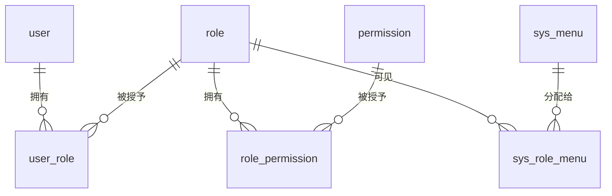

# RABC · RBAC 权限管理系统

> 基于 **Spring Boot 3 + MyBatis-Plus + Redis + RocketMQ** 构建的前后端分离权限管理系统后端，覆盖**登录认证、角色授权、菜单管理、操作审计**的完整闭环。

<p>
  
  
  
  
  
  
</p>

> 项目命名沿用仓库名 **RABC**，实际实现的是 **RBAC**（Role-Based Access Control，基于角色的访问控制）模型。

---

## 目录

- [项目简介](#项目简介)
- [功能特性](#功能特性)
- [技术栈](#技术栈)
- [权限模型](#权限模型)
- [请求处理流程](#请求处理流程)
- [项目结构](#项目结构)
- [快速开始](#快速开始)
- [接口概览](#接口概览)
- [核心设计](#核心设计)
- [后续规划](#后续规划)
- [许可证](#许可证)

---

## 项目简介

RABC 是一个面向后台管理场景的权限管理系统后端。系统以 **用户 — 角色 — 权限 / 菜单** 为核心模型，提供完整的账号体系、细粒度接口鉴权、动态菜单树与异步操作日志能力。

项目在常规 RBAC 的基础上，重点实践了以下工程化能力：

- 基于 **Redis** 的 Token 会话管理与强制下线
- 基于 **自定义注解 + 拦截器** 的接口级权限校验
- 基于 **AOP + RocketMQ + 线程池降级** 的异步操作日志链路
- 统一响应体、统一异常处理、参数校验与多环境配置拆分

## 功能特性

### 🔐 认证与账号

- 登录、登出、注册、修改密码
- BCrypt 密码加密存储（Spring Security Crypto / jBCrypt）
- Redis Token 认证，**2 小时滑动过期**，每次合法请求自动续期
- 支持同一用户多端登录；修改密码、删除用户时通过反向索引**一键踢下线**
- `/login`、`/register` 白名单放行，其余接口统一经过 Token 过滤器

### 🛡️ 权限与角色

- 标准 RBAC 多对多关系：用户 ↔ 角色 ↔ 权限，角色 ↔ 菜单
- 用户分配角色、角色分配权限、角色分配菜单
- 方法级权限注解 `@RequirePerm("user:add")`，拦截器统一校验
- 用户权限列表缓存至 Redis（30 分钟），角色/权限变更后主动清理缓存

### 👥 用户 / 角色 / 权限 / 菜单管理

- 用户、角色、权限、菜单的完整 CRUD
- 权限、菜单、操作日志分页查询与条件筛选
- 菜单树构建（递归分组，支持父子层级）
- 菜单删除前的子菜单、角色绑定校验
- 菜单、权限支持 MyBatis-Plus 逻辑删除

### 📝 操作日志与审计

- 自定义 `@OperateLog` 注解 + AOP 环绕切面，无侵入记录操作
- 记录操作人、模块、描述、请求地址/方式、IP、参数、响应、耗时、异常信息
- 日志优先通过 **RocketMQ** 异步发送，削峰解耦
- MQ 发送异常时降级到**自定义线程池**异步落库，保证日志不阻塞业务
- 消费端基于 `logId` + 数据库唯一索引实现**幂等消费**

### 🧱 工程化

- 统一响应体 `Result<T>` 与结果码枚举 `ResultCode`
- `@RestControllerAdvice` 全局异常处理（业务异常、参数校验、类型错误、404/405、唯一键冲突等）
- Spring Validation 参数校验 + Service 层防御式判空
- 数据源、Redis、RocketMQ 配置拆分，敏感配置通过 `secret.yml` 外部化
- MapStruct 实体转换、Lombok 简化样板代码、自定义异步线程池

## 技术栈

| 分类 | 技术 |
| --- | --- |
| 语言 / 运行时 | Java 21 |
| 应用框架 | Spring Boot 3.3.4、Spring MVC、Spring AOP |
| 持久层 | MyBatis-Plus 3.5.17、MyBatis XML、MySQL 8.x |
| 缓存 / 会话 | Redis、Spring Data Redis |
| 消息队列 | RocketMQ、rocketmq-spring-boot-starter 2.3.5 |
| 安全 | Spring Security Crypto、jBCrypt、自定义 Token + 注解鉴权 |
| 参数校验 | Jakarta Bean Validation |
| 对象转换 / 序列化 | MapStruct 1.6.3、Fastjson2 |
| 辅助工具 | Lombok、Spring Boot DevTools |
| 构建 | Maven 3.9+ / Maven Wrapper |

## 权限模型



- **用户** 通过 `user_role` 关联角色
- **角色** 通过 `role_permission` 关联接口权限标识（如 `user:add`）
- **角色** 通过 `sys_role_menu` 关联菜单，用于构建用户可见的动态菜单树

## 请求处理流程

```mermaid
flowchart LR
    Client[客户端] --> AF[AuthFilter<br/>白名单 / Token 校验]
    AF -->|401 未登录| R1[拒绝访问]
    AF -->|写入 request 上下文| PI[PermissionInterceptor<br/>@RequirePerm 校验]
    PI -->|403 权限不足| R2[拒绝访问]
    PI --> C[Controller]
    C --> S[Service]
    S --> M[(MySQL)]
    S <--> R[(Redis)]
    C -.->|@OperateLog| AOP[AOP 操作日志切面]
    AOP --> MQ[RocketMQ]
    MQ --> Consumer[日志消费者<br/>logId 幂等]
    Consumer --> M
    MQ -.->|发送异常| Async[异步线程池降级]
    Async --> M
```

1. **AuthFilter** 校验白名单与 Token，从 Redis 取出 `TokenData`，将 `userId`、`username`、`permList` 写入 request 域。
2. **PermissionInterceptor** 读取方法上的 `@RequirePerm`，与 request 域中的权限列表比对，完成接口级鉴权。
3. **Controller → Service → Mapper** 执行业务，权限/会话等热点数据读写 Redis。
4. **OperateLogAspect** 拦截 `@OperateLog` 方法，将日志送入 RocketMQ 异步落库；异常时走线程池降级链路。

## 项目结构

```text
RABC-
├── pom.xml
├── mvnw / mvnw.cmd
└── src/main
    ├── java/com/example/rabc
    │   ├── annotation/     # @RequirePerm、@OperateLog
    │   ├── aspect/         # 操作日志 AOP 切面
    │   ├── common/         # Result、业务异常、全局异常、分页
    │   ├── config/         # Filter、拦截器、MyBatis-Plus、Redis、线程池
    │   ├── consumer/       # RocketMQ 操作日志消费者
    │   ├── controller/     # 认证、用户、角色、权限、菜单、日志接口
    │   ├── convert/        # MapStruct 对象转换器
    │   ├── dto/            # 请求参数对象
    │   ├── entity/         # 数据库实体
    │   ├── enums/          # 操作模块枚举、结果码枚举
    │   ├── filter/         # Token 认证过滤器
    │   ├── interceptor/    # 权限拦截器
    │   ├── mapper/         # MyBatis-Plus Mapper
    │   ├── service/        # 业务接口与实现
    │   ├── sql/            # 数据库初始化脚本
    │   ├── vo/             # 视图对象（含菜单树）
    │   └── RabcApplication.java
    └── resources
        ├── application.yml             # 主配置，聚合其他配置文件
        ├── application-datasource.yml  # MySQL + MyBatis-Plus
        ├── application-middleware.yml  # Redis + RocketMQ
        ├── mapper/                     # MyBatis XML
        ├── secret.yml.example          # 敏感配置模板
        └── secret.yml                  # 本地敏感配置（请勿提交真实密钥）
```

## 快速开始

### 1. 环境准备

| 组件 | 版本要求 | 说明 |
| --- | --- | --- |
| JDK | 21 | 项目使用 Java 21 编译 |
| Maven | 3.9+ | 也可直接使用项目自带的 Maven Wrapper |
| MySQL | 8.x | 默认数据库名 `rabc` |
| Redis | 6.x+ | 存储 Token 与权限缓存 |
| RocketMQ | 4.9+ | 用于操作日志；未部署时日志走降级链路 |

### 2. 克隆项目

```bash
git clone https://github.com/changmenhaihu/RABC-.git
cd RABC-
```

### 3. 初始化数据库

```sql
CREATE DATABASE rabc DEFAULT CHARACTER SET utf8mb4 COLLATE utf8mb4_general_ci;
```

然后执行 `src/main/java/com/example/rabc/sql/` 下的初始化脚本，并根据实体类补全所需表结构。

> 提示：仓库中的 SQL 为开发过程中的增量脚本，首次部署时请以 `entity` 包中的字段定义为准，确保 `sys_menu`、`sys_role_menu`、`sys_operate_log` 等表完整。

主要数据表：

| 表名 | 说明 |
| --- | --- |
| `user` | 用户表 |
| `role` | 角色表 |
| `user_role` | 用户-角色关联表 |
| `permission` | 权限表 |
| `role_permission` | 角色-权限关联表 |
| `sys_menu` | 菜单表（支持树形结构） |
| `sys_role_menu` | 角色-菜单关联表 |
| `sys_operate_log` | 操作日志表 |

### 4. 配置敏感信息

```bash
# Windows
copy src\main\resources\secret.yml.example src\main\resources\secret.yml

# macOS / Linux
cp src/main/resources/secret.yml.example src/main/resources/secret.yml
```

在 `secret.yml` 中填写本地 MySQL、Redis、RocketMQ 连接信息：

```yaml
db:
  url: "jdbc:mysql://localhost:3306/rabc?useUnicode=true&characterEncoding=utf8&serverTimezone=Asia/Shanghai"
  username: your_db_user
  password: your_db_password

redis:
  host: 127.0.0.1
  port: 6379
  database: 0
  password: ""

rocketmq:
  name-server: 127.0.0.1:9876
```

> 请勿将包含真实密码的 `secret.yml` 提交到公开仓库。

### 5. 启动项目

```bash
# macOS / Linux
./mvnw spring-boot:run

# Windows
mvnw.cmd spring-boot:run
```

服务默认运行在 `http://localhost:8080`。

### 6. 验证接口

注册一个账号：

```bash
curl -X POST http://localhost:8080/register \
  -H "Content-Type: application/json" \
  -d '{
    "username": "demo",
    "password": "123456",
    "confirmPassword": "123456",
    "nickname": "Demo",
    "email": "demo@example.com"
  }'
```

登录获取 Token：

```bash
curl -X POST http://localhost:8080/login \
  -H "Content-Type: application/json" \
  -d '{"username": "demo", "password": "123456"}'
```

响应示例：

```json
{
  "code": 200,
  "msg": "success",
  "data": "8f14e45fceea167a5a36dedd4bea2543"
}
```

携带 Token 访问受保护接口（支持 `Bearer` 前缀，也兼容直接传 Token）：

```bash
curl http://localhost:8080/me \
  -H "Authorization: Bearer <token>"
```

## 接口概览

| 模块 | 主要接口 | 鉴权标识 |
| --- | --- | --- |
| 认证 | `POST /login`、`POST /logout`、`POST /register`、`GET /me`、`POST /user/changePassword` | 登录/注册为白名单，其余需 Token |
| 用户 | `GET /user/list`、`POST /user/add`、`PUT /user/update`、`DELETE /user/delete/{id}`、`GET /user/{id}/roles` | `user:view` / `user:add` / `user:update` / `user:delete` |
| 角色 | `GET /rbac/role/list`、`POST /rbac/role/add`、`PUT /rbac/role/update`、`DELETE /rbac/role/delete/{id}` | `role:list` / `role:add` / `role:update` / `role:delete` |
| 授权 | `POST /rbac/user/assignRoles`、`POST /rbac/role/assignPerms`、`POST /rbac/assignMenu` | `user:assignRoles` / `role:assignPerm` / `role:assignMenu` |
| 权限 | `GET /permission/list`、`GET /permission/page`、`GET /permission/getPermissionById`、`POST /permission/createpermission`、`PUT /permission/updatePermission`、`DELETE /permission/deletePermission` | `perm:list` / `perm:add` / `perm:edit` / `perm:delete` |
| 菜单 | `GET /menu/list`、`GET /menu/page`、`GET /menu/tree`、`POST /menu/add`、`PUT /menu/update`、`DELETE /menu/delete/{id}`、`PUT /menu/{id}/status` | `menu:list` / `menu:add` / `menu:update` / `menu:delete` |
| 操作日志 | `GET /sys/log/pages` | `log:list` |

## 核心设计

### Token 会话与强制下线

登录成功后生成 UUID Token，Redis 中维护两条索引：

- **正向索引** `token:{token}` → `TokenData`（用户 ID、用户名、权限列表），默认 2 小时过期，每次合法请求滑动续期。
- **反向索引** `user:tokens:{userId}` → 该用户全部有效 Token 集合。

修改密码或删除用户时，通过反向索引批量删除 Token，实现**一次操作、全端下线**。

### 两层鉴权

- **认证层（Filter）**：验证请求是否携带有效 Token，解决“你是谁”。
- **授权层（Interceptor）**：读取 `@RequirePerm`，判断权限列表中是否包含目标权限标识，解决“你能不能做”。

认证阶段一次性将权限列表写入 request 域，后续拦截器和 Controller 直接复用，避免同一请求重复查询 Redis。

### 操作日志异步化

```text
@OperateLog → AOP 环绕通知 → RocketMQ → 消费者 → MySQL
                              ↘ 发送异常 → 自定义线程池异步落库
```

- 日志采集与业务执行解耦，避免同步写库拖慢接口。
- 每条日志生成全局唯一 `logId`，消费者先查后写，并由数据库唯一索引兜底，防止重复消费。
- 线程池采用 `CallerRunsPolicy`，队列满时由调用线程执行，尽量不丢任务。

### 缓存一致性

- 登录时聚合用户权限标识并缓存 30 分钟。
- 为用户分配角色、为角色分配权限时，删除相关用户的权限缓存。
- 为角色分配菜单时，删除相关用户的菜单缓存，下次查询自动重建。

## 后续规划

- [ ] 集成 OpenAPI / Swagger 接口文档
- [ ] 提供 Docker Compose 一键启动 MySQL + Redis + RocketMQ
- [ ] 补充 Service 层单元测试与接口集成测试
- [ ] 引入数据权限（部门 / 自定义范围）与更细粒度的授权策略
- [ ] 对接前端管理台，提供动态路由与按钮级权限示例

## 许可证

本项目暂未声明开源许可证，仅用于学习与技术交流。如需引用或二次开发，请注明项目来源。

---

**仓库地址**：https://github.com/changmenhaihu/RABC-

如果这个项目对你有帮助，欢迎 Star ⭐
